# Entity Relationship Diagram - bar_management_db

Generated from `database/schema.sql`: **21 tables**, **38 foreign keys**, all with `ON DELETE RESTRICT` (financial records can never be deleted by accident), except `audit_logs.user_id` which is `SET NULL`.

The picture is in **`erd.png`** (and `erd.svg`, which stays sharp when printed). The same diagram as text, for tools that read Mermaid:

```mermaid
erDiagram
    roles {
        INT id PK
        VARCHAR name UK
        VARCHAR description
        TIMESTAMP created_at
    }
    users {
        INT id PK
        INT role_id FK
        VARCHAR full_name
        VARCHAR username UK
        VARCHAR email UK
        VARCHAR phone
        VARCHAR password_hash
        ENUM status
        DATETIME last_login_at
        TIMESTAMP created_at
        TIMESTAMP updated_at
    }
    categories {
        INT id PK
        VARCHAR name UK
        VARCHAR description
        ENUM status
        TIMESTAMP created_at
        TIMESTAMP updated_at
    }
    products {
        INT id PK
        VARCHAR product_code UK
        INT category_id FK
        VARCHAR name
        VARCHAR brand
        VARCHAR barcode UK
        VARCHAR base_unit
        DECIMAL purchase_price
        DECIMAL avg_cost
        DECIMAL selling_price
        INT quantity_in_stock
        INT min_stock
        DATE expiry_date
        ENUM status
        TIMESTAMP created_at
        TIMESTAMP updated_at
    }
    product_units {
        INT id PK
        INT product_id FK
        VARCHAR unit_name
        INT conversion_factor
        DECIMAL selling_price
        TINYINT is_base
        TIMESTAMP created_at
    }
    suppliers {
        INT id PK
        VARCHAR supplier_code UK
        VARCHAR name
        VARCHAR business_name
        VARCHAR phone
        VARCHAR email
        VARCHAR address
        ENUM status
        TIMESTAMP created_at
        TIMESTAMP updated_at
    }
    purchases {
        INT id PK
        VARCHAR reference_no UK
        INT supplier_id FK
        DATE purchase_date
        DECIMAL total_cost
        DECIMAL amount_paid
        DECIMAL balance
        ENUM status
        VARCHAR notes
        INT created_by FK
        INT confirmed_by FK
        DATETIME confirmed_at
        INT cancelled_by FK
        DATETIME cancelled_at
        VARCHAR cancel_reason
        TIMESTAMP created_at
        TIMESTAMP updated_at
    }
    purchase_items {
        INT id PK
        INT purchase_id FK
        INT product_id FK
        INT unit_id FK
        INT quantity
        INT base_quantity
        DECIMAL unit_cost
        DECIMAL cost_per_base_unit
        DECIMAL total_cost
    }
    customers {
        INT id PK
        VARCHAR customer_code UK
        VARCHAR full_name
        VARCHAR phone
        VARCHAR address
        DECIMAL credit_limit
        DECIMAL current_debt
        ENUM status
        TIMESTAMP created_at
        TIMESTAMP updated_at
    }
    cash_sessions {
        INT id PK
        INT opened_by FK
        INT closed_by FK
        DATETIME opened_at
        DATETIME closed_at
        DECIMAL opening_balance
        DECIMAL expected_closing
        DECIMAL counted_closing
        DECIMAL variance
        ENUM status
        VARCHAR notes
    }
    sales {
        INT id PK
        VARCHAR receipt_no UK
        INT customer_id FK
        INT cash_session_id FK
        DATETIME sale_date
        DECIMAL subtotal
        DECIMAL discount
        DECIMAL total_amount
        DECIMAL amount_paid
        DECIMAL credit_amount
        ENUM status
        INT sold_by FK
        INT discount_by FK
        INT cancelled_by FK
        DATETIME cancelled_at
        VARCHAR cancel_reason
        TIMESTAMP created_at
    }
    sale_items {
        INT id PK
        INT sale_id FK
        INT product_id FK
        INT unit_id FK
        INT quantity
        INT base_quantity
        DECIMAL unit_price
        DECIMAL unit_cost
        DECIMAL subtotal
        DECIMAL cost_total
    }
    payments {
        INT id PK
        INT sale_id FK
        ENUM method
        DECIMAL amount
        VARCHAR reference
        INT received_by FK
        DATETIME paid_at
    }
    customer_debts {
        INT id PK
        INT customer_id FK
        INT sale_id FK
        DECIMAL original_amount
        DECIMAL paid_amount
        DECIMAL balance
        ENUM status
        TIMESTAMP created_at
        TIMESTAMP updated_at
    }
    debt_payments {
        INT id PK
        INT customer_id FK
        INT customer_debt_id FK
        INT cash_session_id FK
        DECIMAL amount
        ENUM method
        VARCHAR reference
        INT received_by FK
        DATETIME paid_at
        VARCHAR notes
    }
    expense_categories {
        INT id PK
        VARCHAR name UK
        VARCHAR description
        ENUM status
        TIMESTAMP created_at
    }
    expenses {
        INT id PK
        VARCHAR expense_code UK
        INT expense_category_id FK
        INT cash_session_id FK
        VARCHAR description
        DECIMAL amount
        ENUM payment_method
        DATE expense_date
        INT recorded_by FK
        TIMESTAMP created_at
    }
    stock_adjustments {
        INT id PK
        INT product_id FK
        ENUM adjustment_type
        ENUM direction
        INT base_quantity
        VARCHAR reason
        INT adjusted_by FK
        TIMESTAMP created_at
    }
    stock_movements {
        INT id PK
        INT product_id FK
        ENUM movement_type
        INT quantity_change
        INT balance_after
        DECIMAL unit_cost
        VARCHAR reference_type
        INT reference_id
        VARCHAR reason
        INT created_by FK
        TIMESTAMP created_at
    }
    cash_transactions {
        INT id PK
        INT cash_session_id FK
        ENUM txn_type
        ENUM direction
        DECIMAL amount
        VARCHAR reference_type
        INT reference_id
        VARCHAR description
        INT recorded_by FK
        TIMESTAMP created_at
    }
    audit_logs {
        BIGINT id PK
        INT user_id FK
        VARCHAR action
        VARCHAR entity_type
        INT entity_id
        TEXT details
        VARCHAR ip_address
        TIMESTAMP created_at
    }
    roles ||--o{ users : "role_id"
    categories ||--o{ products : "category_id"
    products ||--o{ product_units : "product_id"
    suppliers ||--o{ purchases : "supplier_id"
    users ||--o{ purchases : "created_by"
    users ||--o{ purchases : "confirmed_by"
    users ||--o{ purchases : "cancelled_by"
    purchases ||--o{ purchase_items : "purchase_id"
    products ||--o{ purchase_items : "product_id"
    product_units ||--o{ purchase_items : "unit_id"
    users ||--o{ cash_sessions : "opened_by"
    users ||--o{ cash_sessions : "closed_by"
    customers ||--o{ sales : "customer_id"
    cash_sessions ||--o{ sales : "cash_session_id"
    users ||--o{ sales : "sold_by"
    users ||--o{ sales : "discount_by"
    users ||--o{ sales : "cancelled_by"
    sales ||--o{ sale_items : "sale_id"
    products ||--o{ sale_items : "product_id"
    product_units ||--o{ sale_items : "unit_id"
    sales ||--o{ payments : "sale_id"
    users ||--o{ payments : "received_by"
    customers ||--o{ customer_debts : "customer_id"
    sales ||--o{ customer_debts : "sale_id"
    customers ||--o{ debt_payments : "customer_id"
    customer_debts ||--o{ debt_payments : "customer_debt_id"
    cash_sessions ||--o{ debt_payments : "cash_session_id"
    users ||--o{ debt_payments : "received_by"
    expense_categories ||--o{ expenses : "expense_category_id"
    cash_sessions ||--o{ expenses : "cash_session_id"
    users ||--o{ expenses : "recorded_by"
    products ||--o{ stock_adjustments : "product_id"
    users ||--o{ stock_adjustments : "adjusted_by"
    products ||--o{ stock_movements : "product_id"
    users ||--o{ stock_movements : "created_by"
    cash_sessions ||--o{ cash_transactions : "cash_session_id"
    users ||--o{ cash_transactions : "recorded_by"
    users ||--o{ audit_logs : "user_id"
```

## The relationships required by the brief

| Required relationship | One side (parent) | Many side (foreign key) |
|---|---|---|
| One category has many products | `categories` | `products.category_id` |
| One supplier has many purchases | `suppliers` | `purchases.supplier_id` |
| One purchase has many purchase items | `purchases` | `purchase_items.purchase_id` |
| One product appears in many purchase items | `products` | `purchase_items.product_id` |
| One customer has many sales | `customers` | `sales.customer_id` |
| One sale has many sale items | `sales` | `sale_items.sale_id` |
| One product appears in many sale items | `products` | `sale_items.product_id` |
| One sale can have multiple payments (split payments) | `sales` | `payments.sale_id` |
| One customer can have multiple debt payments | `customers` | `debt_payments.customer_id` |
| One product has many stock movements | `products` | `stock_movements.product_id` |
| One user records many transactions | `users` | `sales.sold_by` |

## Other design decisions

- Stock is stored in the **base unit** (bottle or can). `product_units.conversion_factor` converts crates and packs (1 crate = 20 bottles), so selling 7 bottles from 1 crate leaves 13.
- `sale_items.unit_cost` copies the weighted average cost **at the moment of the sale**, so profit stays correct when prices change later.
- `stock_movements` records every change of stock (purchase, sale, cancellation, adjustment) with the balance after it.
- `cash_transactions` records every cash movement of a `cash_sessions` row, which is how the daily cash reconciliation is calculated.
- Credit is tracked separately from cash: `sales.credit_amount` -> `customer_debts` -> `debt_payments`.
- Every table that records an action stores the responsible user (`created_by`, `sold_by`, `recorded_by`, ...), and `audit_logs` keeps the history of sensitive operations.
